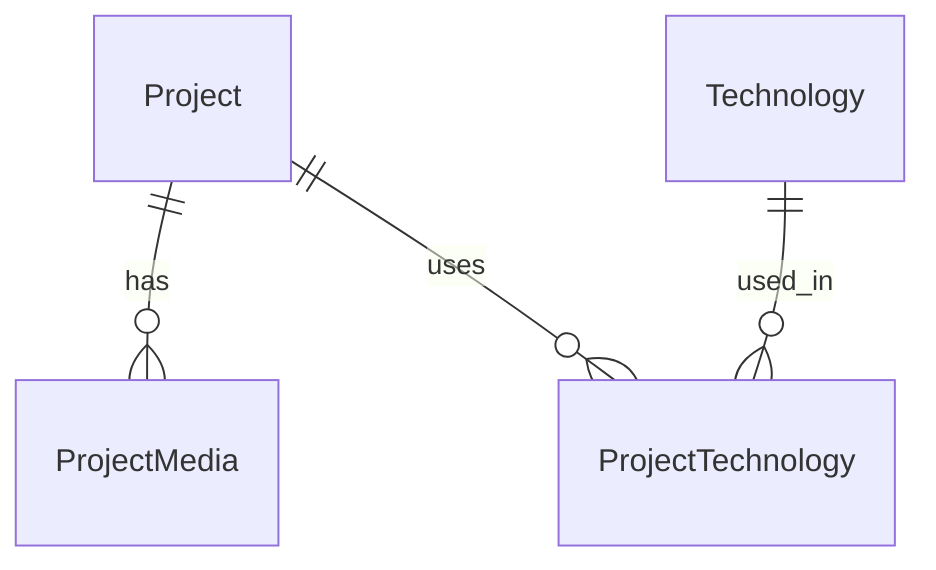

# Veritabanı Şeması

Kaynak: `prisma/schema.prisma` (çelişki halinde o geçerlidir; değişiklikte bu dosya aynı işte güncellenir). İlk migration: `20261030203706_init`. PostgreSQL 17 (yerel Docker), Prisma 7.10.1 + `@prisma/adapter-pg`.

Blog modelleri (Article, Tag, ArticleTag) v1.1'de ayrı migration ile eklenecek.

## ER özeti

`AdminUser`, `Profile`, `SiteSettings`, `Experience`, `Education`, `ContactSubmission` bağımsız tablolardır.

## Modeller

Ortak: `createdAt`, `updatedAt`. Yayınlanabilir içerikte `status` (`DRAFT | PUBLISHED`, varsayılan `DRAFT`).

| Model | Ana alanlar / kısıtlar |
|---|---|
| AdminUser | `email` (unique, küçük harfe çevrilir), `passwordHash` (argon2id), `role` (`ADMIN`), `lastLoginAt`, `failedLoginCount` + `lockedUntil` (5 ardışık hatalı girişte 15 dk kilit; başarılı girişte sıfırlanır). `sessionVersion` (çıkış/parola değişiminde artar, eski oturumları iptal eder). Migration'lar: `admin_login_lockout`, `admin_session_version` |
| Profile | Tek satır (`id = "singleton"`). Tüm alanlar opsiyonel: fullName, headline, statement, bio, location, contactEmail, githubUsername, linkedinUrl, xUrl, websiteUrl, cvUrl, avatarUrl. Uydurma içerik yok |
| SiteSettings | Tek satır (`singleton`): siteTitle, siteDescription, ogImageUrl, githubLastSyncAt, githubLastSyncError |
| Project | `slug` (unique), title, summary, opsiyonel Text alanları (overview, problem, solution, architecture, implementation, challenges, results), status, featured, sortOrder, repoUrl, liveUrl, `githubRepo` ("owner/name", unique, null = manuel proje), GitHub cache alanları (githubStars, githubLanguage, githubPushedAt, githubSyncedAt), publishedAt. Index: (status, featured, sortOrder), (status, publishedAt) |
| ProjectMedia | projectId (FK, cascade), url, `alt` (zorunlu), sortOrder. Index: (projectId, sortOrder) |
| Technology | `name` (unique), `slug` (unique), category (`LANGUAGE/FRONTEND/BACKEND/DATABASE/DEVOPS/TOOL`), isKeySkill, sortOrder |
| ProjectTechnology | Bileşik PK (projectId, technologyId), her iki FK cascade. Index: technologyId |
| Experience | company, role, location, startDate, endDate (null = devam), description, status, sortOrder. Index: (status, startDate) |
| Education | institution, degree, field, startDate, endDate, description, status, sortOrder. Index: (status, startDate) |
| ContactSubmission | name, email, message, status (`NEW/READ/ARCHIVED`), `ipHash` (tuzlanmış hash; ham IP saklanmaz). Index: (status, createdAt) |

## Seed (`prisma/seed.ts`)

İdempotent. Boş `Profile` ve `SiteSettings` satırlarını oluşturur. `ADMIN_EMAIL` ve `ADMIN_INITIAL_PASSWORD` (en az 12 karakter) ayarlıysa ilk admin'i oluşturur; var olan admin'in parolasına dokunmaz. Portfolyo içeriği üretmez.

## Komutlar

`npm run db:generate | db:migrate | db:deploy | db:seed`. Yerel DB: `docker compose up -d db` (host portu 5433). Entegrasyon testleri `portfolio_test` veritabanında çalışır ve veritabanı adı `_test` ile bitmiyorsa kendini durdurur.

## Kurallar

- Production'da yalnızca `migrate deploy` (onayla). `migrate reset` yasak.
- Gereksiz kişisel veri saklanmaz; ContactSubmission saklama süresi M7'de belirlenecek.
- Yedekleme: yönetilen sağlayıcının otomatik yedeği + bir kez geri yükleme denemesi (M9).
